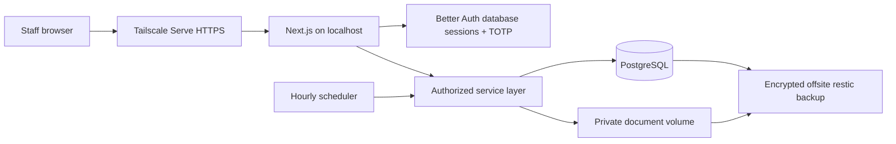

# Architecture

Wintron OS is a Next.js App Router modular monolith. PostgreSQL is the system of record. Prisma is the data-access layer; all financial calculations use Decimal.js and PostgreSQL NUMERIC. React/Recharts use numeric conversion only for display and chart coordinates. The app starts with no business records; explicit development seeding is isolated from normal installation.

## Boundaries

- `app/api/auth/[...all]`: Better Auth. Email/password signup disabled. Accounts are provisioned by an owner or the first-owner CLI. Scrypt password hashing, revocable database sessions, TOTP, hashed/encrypted recovery material, rate limiting and origin checks are supplied by Better Auth.
- `lib/security.ts`: derives organization and role from active database membership, never a request tenant parameter. Every business API request verifies session/membership. Mutation routes require an exact trusted origin.
- `lib/services`: client operations, invoices, payment allocation, ledger posting, reports, private documents. Financial writes and audit events share serializable transactions with bounded retries.
- `lib/validation.ts`: Zod schemas bound strings, dates, percentages, lists and amounts. Unknown properties are stripped.
- `prisma/migrations`: versioned schema and database constraints/triggers. Issued documents, journals, refunds, allocations and audit events cannot be casually edited/deleted.
- `components`: shared design tokens, accessible Radix dialogs, responsive shell, forms, tables, chart, client profiles and all nine modules.
- `scripts/jobs.ts`: scheduled draft generation and notifications; runs hourly in Compose. Scheduled draft uniqueness is enforced by `(retainerId,billingPeriod)`.

## Financial posting rules

| Event                                       | Debit                      | Credit                                         |
| ------------------------------------------- | -------------------------- | ---------------------------------------------- |
| Issue invoice                               | Accounts receivable        | Service revenue + configured sales tax payable |
| Receive allocated payment                   | Cash                       | Accounts receivable                            |
| Receive unapplied payment                   | Cash                       | Unapplied customer payments (liability)        |
| Apply existing payment                      | Unapplied payments         | Accounts receivable                            |
| Refund allocation                           | Accounts receivable        | Cash                                           |
| Refund unapplied cash                       | Unapplied payments         | Cash                                           |
| Paid operating expense                      | Configured expense account | Cash                                           |
| Owner contribution                          | Cash                       | Owner capital                                  |
| Owner distribution / owner tax distribution | Owner distributions        | Cash                                           |
| Entity tax payment                          | Configured tax liability   | Cash                                           |
| Void issued invoice / reverse expense       | Exact original credits     | Exact original debits                          |

Income tax obligations must be accrued through a reviewed adjustment before entity tax payments can represent an actual liability reduction. Tax reserve assumptions are not postings. Earmarking is not an actual cash transfer; use a reviewed cash-to-reserve journal if money is moved between configured cash accounts.

Invoice total rounding: quantity × unit price to cents, percentage discount to cents, sales tax on net line amount to cents, then sum rounded lines. Final issuance saves company and client identity snapshots. Status is derived from immutable issued total, allocations and refunds; delivery events are separate. Corrections refund allocated cash before voiding/reissuing; there is no silent mutation of finalized financial records.

The reference's monthly metric is explicitly presented as selected-period accrual revenue. Balance sheet and cash balances are cumulative through the selected period end. Accounts receivable aging and invoice status represent current balances, visibly labeled. Retainer MRR/ARR are active contract run rates, not collected or recognized revenue.

## Tax planning

Versioned, effective-dated tax configurations contain user-entered planning percentages, source references, classification, review notes and earmarked amount. No statutory bracket, deadline, deduction, election, sales tax applicability or owner residency is fabricated. Default classification is UNCONFIRMED. Owner percentages must total 100% before allocation estimates display. Book profit allocation does not determine taxable income.

No jurisdiction-specific obligation calculation or filing engine is enabled. Official starting points: [IRS LLC guidance](https://www.irs.gov/businesses/small-businesses-self-employed/limited-liability-company-llc) and [South Carolina DOR](https://dor.sc.gov/). Rates and individualized rules require accountant validation before implementing an obligation engine.

## Initial operating envelope

The current UI loads an organization's operational records and report journal history for a small internal business. Pagination and incremental aggregates are required before large-volume or multi-customer SaaS use. A user has one active selected organization (first active membership); public tenant provisioning and tenant switching are intentionally absent. Composite foreign keys protect financial organization relationships; service checks protect auxiliary client/project/document associations.
